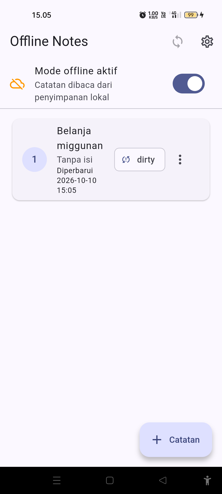
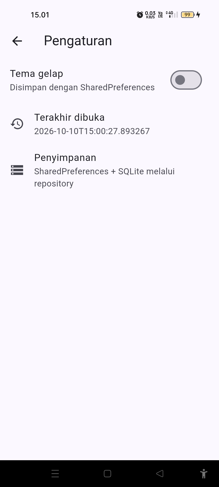
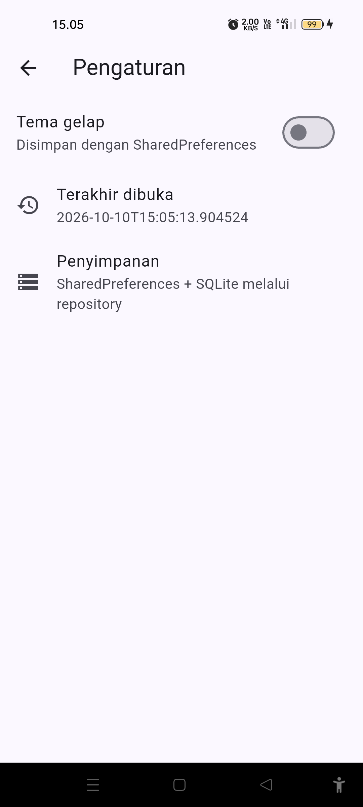

# Week 7 — Clean Architecture

| Identitas Mahasiswa | Keterangan |
|---|---|
| **Nama** | Fikar Bahrul Santoso |
| **NIM** | 244107020160 |
| **Mata Kuliah** | Pemrograman Mobile |

## Tentang Project

Project ini merupakan **refactor** aplikasi Offline Notes dari Minggu 5 ke
struktur **Clean Architecture feature-first**. Kode yang sudah berjalan
dipindahkan dan dipisahkan per layer tanpa menambah fitur baru. Fokusnya adalah
arah dependensi `presentation` bergantung ke `domain`, dan `data`
mengimplementasikan `domain`, sehingga `domain` bebas dari Flutter, Dio, SQLite,
maupun Firebase.

## Diagram Layer dan Arah Dependensi

```text
presentation (widget, notifier, provider wiring)
     |  bergantung ke
     v
  domain (entity, repository interface, use case, failure)
     ^  diimplementasikan oleh
     |
  data (model, repository impl, Dio, SQLite, SharedPreferences)

Aturan emas: dependensi hanya mengarah ke dalam (ke domain).
```

## Fitur

- CRUD catatan offline dengan badge `dirty` (fitur `notes`)
- Mode offline/online dan simulasi sinkronisasi
- Tema gelap/terang dan waktu terakhir dibuka (fitur `settings`)
- Cache-first posts JSONPlaceholder (fitur `posts`)
- Entity murni tanpa mapping, mapping hanya di model
- DI terpusat lewat Riverpod, widget tidak menginstansiasi repository
- Formatting tanggal murni di `lib/core/format.dart`

## Stack Teknologi

| Teknologi | Penggunaan |
|---|---|
| Flutter / Dart | Framework dan bahasa |
| Riverpod | State management dan dependency injection |
| sqflite | Penyimpanan catatan dan cache posts |
| shared_preferences | Tema dan waktu terakhir dibuka |
| Dio | Refresh posts di background |
| Android — Oppo Reno 7z 5G | Perangkat uji fisik melalui USB debugging |

## Struktur Project

```text
07-week-7-clean-architecture/
├── README.md
├── docs/
│   └── AI_Prompt_Challenge.md
├── screenshots/
├── lib/
│   ├── core/
│   │   ├── failures.dart
│   │   └── format.dart
│   ├── features/
│   │   ├── notes/
│   │   │   ├── domain/        (entities, repositories, usecases)
│   │   │   ├── data/          (models, repositories, datasources)
│   │   │   └── presentation/  (providers, pages)
│   │   ├── settings/
│   │   │   ├── domain/
│   │   │   ├── data/
│   │   │   └── presentation/
│   │   └── posts/
│   │       ├── domain/
│   │       ├── data/
│   │       └── presentation/
│   ├── main.dart
│   └── routes.dart
└── test/
```

## Menjalankan Project

```bash
cd 07-week-7-clean-architecture/
flutter pub get
flutter run
```

Perangkat fisik yang dipakai: Oppo Reno 7z 5G (`CPH2343`).

## Praktikum 1 — Audit Layer Project Lama

Pemetaan file week5 ke layer dan masalahnya:

| File | Layer saat ini | Masalah |
|---|---|---|
| `pages/notes_page.dart` | presentation | Sudah lewat provider, tetapi source data tersebar di `data/` |
| `pages/settings_page.dart` | presentation | Memakai `FutureBuilder` + `PrefsRepository` campur |
| `data/providers.dart` | data (+state) | Notifier (state) tinggal di layer data |
| `data/local/note.dart` | data | Entity bercampur `toMap/fromMap` |
| `data/repositories/note_repository.dart` | data | Tidak ada interface; kontrak dan implementasi satu kelas |
| `data/prefs.dart` | data | Tidak ada interface repository |
| `data/sync.dart` | data | Dio + `jsonDecode` + SQLite bercampur satu fungsi |

Hasil tiga grep pada kode lama:

```text
# 1. Widget menyentuh jaringan/database  -> 0 hasil
# 2. Logika bisnis di pages               -> 0 hasil
# 3. Instansiasi manual di pages/providers -> "PrefsRepository()", "NoteRepository()" (wiring data/providers.dart)
```

Kesimpulan audit: presentation relatif bersih, tetapi pelanggaran struktur ada di
layer data — entity bercampur mapping, repository tanpa interface, notifier
berada di layer data, dan logika posts bercampur Dio/SQLite.

## Praktikum 2 — Domain dan Data per Fitur

- `domain/entities/note.dart`: entity murni tanpa `toMap/fromMap`.
- `domain/repositories/note_repository.dart`: interface dengan return record
  `({List<Note> notes, Failure? failure})` agar sukses/gagal eksplisit.
- `core/failures.dart`: `sealed class Failure` dengan `LocalFailure` dan
  `NetworkFailure`.
- `domain/usecases/get_notes.dart` dan `sync_notes.dart`.
- `data/models/note_model.dart`: hanya di sini ada `toMap/fromMap/toEntity`.
- `data/repositories/note_repository_impl.dart`: memenuhi kontrak memakai sqflite.

## Praktikum 3 — Presentation, DI, dan Verifikasi

- `presentation/providers/notes_providers.dart`: satu tempat wiring DI.
- `presentation/pages/notes_page.dart`: hanya membaca state; tidak ada SQL, Dio,
  JSON, atau mapping.
- Verifikasi dependency rule (semuanya lolos):

```text
# A. Presentation steril dari data mentah
rg "Dio\(|openDatabase|getDatabasesPath|FlutterSecureStorage|SharedPreferences\.getInstance|jsonDecode" \
   lib/features/*/presentation        => 0 hasil
# B. Domain steril dari framework & package
rg "import 'package:flutter|import 'package:dio|import 'package:sqflite|import 'package:firebase" \
   lib/features/*/domain lib/core     => 0 hasil
# C. flutter analyze => bersih ; flutter test => 6 test lulus
```

## Hasil Refactor — Before / After

UI tetap sama sebelum dan sesudah refactor (struktur yang berubah). Satu tambahan
kecil adalah baris waktu `Diperbarui ...` pada kartu catatan, hasil ekstraksi
fungsi `formatDateTime` di `core/format.dart`.

Daftar catatan — sebelum vs sesudah:




Halaman Pengaturan — sebelum vs sesudah:





## AI Challenge

Prompt, tabel usulan-versus-keputusan final, perbaikan manual, checklist
verifikasi, dan hasil tiga grep tersedia di
[docs/AI_Prompt_Challenge.md](docs/AI_Prompt_Challenge.md).

Keputusan akhir:

- Interface repository di `domain`, implementasi di `data`, mapping hanya di model.
- Use case hanya `GetNotes` dan `SyncNotes`. CRUD satu-baris langsung ke repository.
- Pembuka database diletakkan di data layer agar `core` tetap steril.

## Testing

```bash
dart format lib test
flutter analyze
flutter test
```

Test mencakup:

- `GetNotes` meneruskan daftar dari repository (fake)
- `GetNotes` meneruskan `Failure` tanpa melempar
- `NoteModel.fromMap` aman terhadap field yang hilang
- Flag `dirty` bertahan pada serialisasi model
- `formatDateTime` menghasilkan tanggal yang dapat diprediksi
- Smoke test halaman Offline Notes

## Refleksi

### Mengapa interface repository harus tinggal di domain, bukan di data?

Karena `domain` adalah pemilik aturan bisnis dan mendefinisikan kontrak yang
dibutuhkannya. Bila interface diletakkan di `data`, `domain` terpaksa mengimpor
`data` dan arah dependensi terbalik: `domain` jadi tahu tentang implementasi.
Akibatnya `domain` sulit diuji tanpa SQLite/Dio dan penggantian sumber data
memaksa perubahan di `domain`.

### Kapan use case benar-benar dibutuhkan?

Saat operasi menggabungkan lebih dari satu repository atau memuat aturan bisnis,
seperti `SyncNotes` (hitung dirty → upload → tandai bersih). Untuk CRUD
satu-baris, repository langsung ke notifier sudah cukup dan lebih sederhana.

### Apa biaya over-engineering use case per CRUD?

Setiap use case menambah satu file dan satu lapisan indireksi yang harus dibaca,
diuji, dan dirawat. Untuk tim kecil dengan fitur sederhana, biaya perawatan ini
lebih besar daripada manfaatnya. Use case sepadan ketika logika bisnis tumbuh atau
beberapa tim berbagi kontrak yang sama.

### Bagian mana dari usulan AI yang ditolak atau disederhanakan?

Use case untuk tiap CRUD satu-baris saya tolak (cukup repository langsung), dan
pembuka database saya pindahkan dari `core/` ke data layer agar `core` terbukti
steril saat diperiksa dengan grep.

## Checklist Verifikasi

- [Berhasil] Tiga grep sterilitas nol hasil
- [Berhasil] Interface di `domain`, implementasi di `data`, mapping hanya di model
- [Berhasil] Widget tidak menginstansiasi repository; semua lewat provider
- [Berhasil] Aplikasi berjalan identik sebelum/sesudah refactor (bukti screenshot)
- [Berhasil] `flutter analyze` bersih dan 6 test lulus
- [Berhasil] APK terinstal dan dijalankan di device fisik Oppo Reno 7z 5G

## Kesimpulan

Refactor Offline Notes ke Clean Architecture feature-first berhasil memisahkan
layer `presentation`, `domain`, dan `data` dengan arah dependensi yang benar.
`domain` dan `core` terbukti steril dari framework melalui grep, sementara
perilaku aplikasi tetap sama seperti sebelum refactor. Keputusan penting yang
diambil adalah menghindari over-engineering use case per CRUD, dan meletakkan
infrastruktur database di data layer.