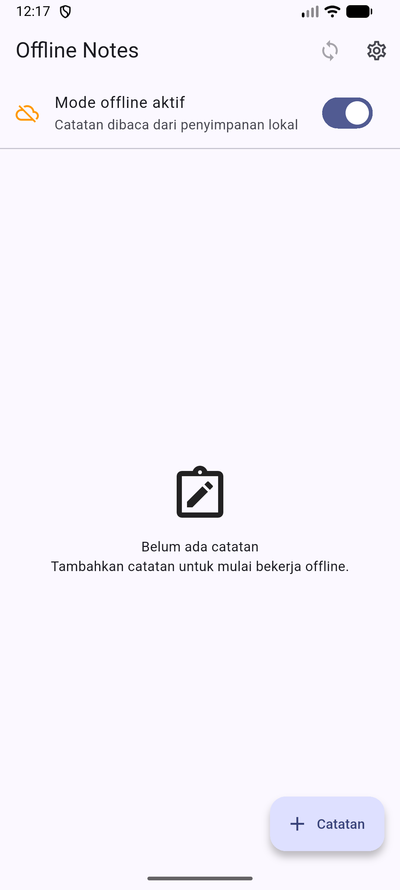
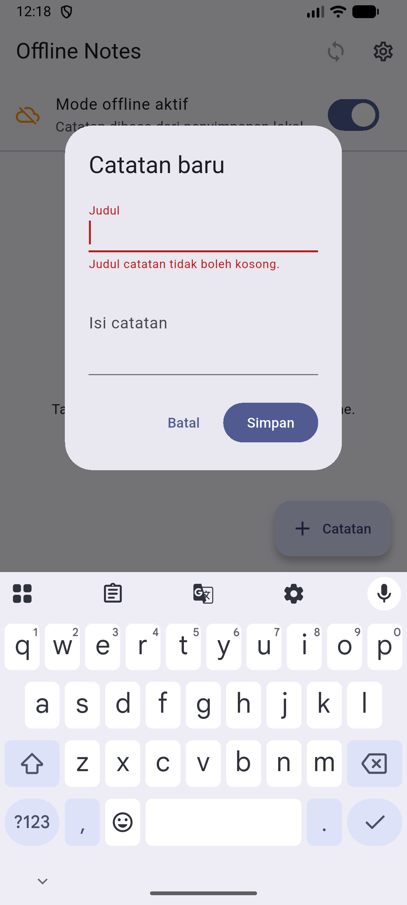
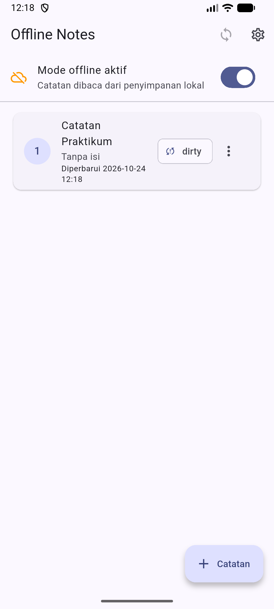
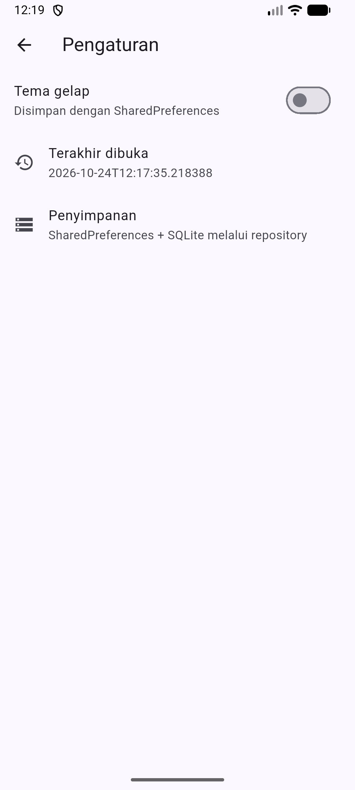
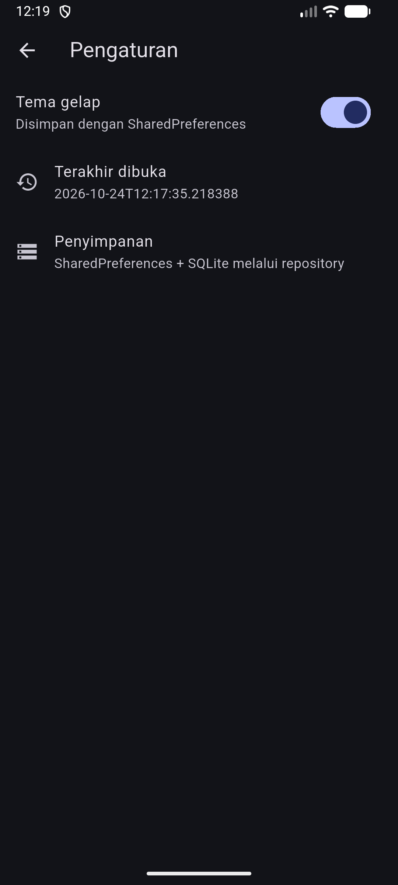

# Week 8 — Mid Project Review & Code Review

| Identitas Mahasiswa | Keterangan |
|---|---|
| **Nama** | Fikar Bahrul Santoso |
| **NIM** | 244107020160 |
| **Mata Kuliah** | Pemrograman Mobile |

## Tentang Project

Minggu ini bukan membangun fitur baru, melainkan **meninjau ulang** project
Minggu 5–7 (Offline Notes Clean Architecture). Fokusnya ada pada disiplin
kolaborasi: higiene branch dan commit, satu Pull Request kecil yang direview
sejawat, menjalankan static analysis sampai bersih, lalu menilai kesiapan
project untuk paruh kedua semester.

Perubahan kode yang dibawa minggu ini hanya satu PR kecil: **validasi judul
kosong** pada dialog catatan. Sisanya bersifat dokumentasi dan verifikasi.

## Fitur

- CRUD catatan offline dengan badge `dirty` (fitur `notes`)
- Validasi judul kosong dengan pesan error di dialog (hasil PR minggu ini)
- Mode offline/online dan simulasi sinkronisasi
- Tema gelap/terang dan waktu terakhir dibuka (fitur `settings`)
- Cache-first posts JSONPlaceholder (fitur `posts`)

## Stack Teknologi

| Teknologi | Penggunaan |
|---|---|
| Flutter / Dart | Framework dan bahasa |
| Riverpod | State management dan dependency injection |
| sqflite | Penyimpanan catatan dan cache posts |
| shared_preferences | Tema dan waktu terakhir dibuka |
| Dio | Refresh posts di background |
| GitHub Actions | CI penolak otomatis PR kotor |
| Android — emulator Medium_Phone | Perangkat uji (port 5554) |

## Struktur Project

```text
08-week-8-mid-project-review/
├── README.md
├── docs/
│   ├── review-checklist.md        (Praktikum 1 & 3)
│   ├── peer-review.md             (Praktikum 2)
│   └── ai-review-vs-keputusan.md  (AI Challenge)
├── .github/workflows/ci.yml
├── screenshots/
├── lib/
│   ├── core/          (failures, format, validate)
│   └── features/      (notes, settings, posts: domain/data/presentation)
└── test/
```

## Menjalankan Project

```bash
cd 08-week-8-mid-project-review/
flutter pub get
flutter run
```

Perangkat uji: emulator Medium_Phone (`emulator-5554`).

## Peta Issue dan Pull Request

| Item | Isi | Status |
|---|---|---|
| Issue #12 | Catatan bisa tersimpan tanpa judul | Closed otomatis oleh PR #13 |
| PR #13 | `feat(notes): validasi judul kosong + pesan error di UI` → `develop` | Merged (squash) |
| Branch | `feat/notes-validation` dari `develop` | Dihapus setelah merge |
| Reviewer | Nanda | Request changes → Approve |

Branch `develop` dibuat dari `main` agar `main` tidak disentuh langsung lagi.

## Praktikum 1 — Higiene Branch dan Commit

Riwayat awal repository semua masuk ke `main` dengan pesan seadanya
(`Jobsheet 5` bahkan muncul dua kali). Branch kerja ditata ulang dan tiga pesan
commit lama ditulis ulang ke format `tipe(scope): deskripsi singkat`. Tabel
lengkap sebelum/sesudah ada di [docs/review-checklist.md](docs/review-checklist.md).



## Praktikum 2 — PR dan Peer Review

PR kecil #13 dibuka dari `feat/notes-validation` ke `develop` dengan template
lengkap (masalah → solusi → cara uji). Reviewer sejawat **Nanda** memberi
**Request changes** dengan lima temuan: judul berisi spasi masih lolos,
pesan error tidak hilang, validasi susah dites, belum ada test, dan satu saran
nama record. Author memperbaiki temuan 1–4, lalu PR di-approve dan di-merge.

Validasi judul kosong yang tampil di dialog:



Catatan dengan judul valid berhasil disimpan:



Rincian dan komentar review ada di [docs/peer-review.md](docs/peer-review.md).

## Praktikum 3 — Static Analysis dan Mid Review

```text
flutter analyze                       => No issues found!
dart format --set-exit-if-changed .   => tidak ada file berubah
flutter test                          => All tests passed! (9 test)
```

Penolakan otomatis lewat `.github/workflows/ci.yml` menjalankan `flutter analyze`
dan `flutter test` pada setiap PR. Penilaian kesiapan tengah semester (struktur,
analyze, test, PR, README, tindak lanjut review) semuanya terpenuhi dan
tercatat di [docs/review-checklist.md](docs/review-checklist.md).

Halaman pengaturan, bukti aplikasi berjalan identik dengan akhir Minggu 7:



Mode gelap tetap berjalan setelah refactor:



## AI Challenge

Prompt, tabel usulan-versus-keputusan, serta bukti penerimaan dan penolakan
tersedia di [docs/ai-review-vs-keputusan.md](docs/ai-review-vs-keputusan.md).
Ringkasnya: 3 temuan AI diterima (spasi, ekstraksi validasi, reset error) dan
2 ditolak (use case per CRUD, ganti provider Riverpod).

## Testing

```bash
dart format --set-exit-if-changed .
flutter analyze
flutter test
```

Test mencakup:

- `GetNotes` meneruskan daftar dan `Failure` tanpa melempar
- `NoteModel.fromMap` aman terhadap field hilang dan flag `dirty`
- `formatDateTime` menghasilkan tanggal dapat diprediksi
- `validateNoteTitle` menolak judul kosong dan spasi, menerima judul valid
- Smoke test halaman Offline Notes

## Refleksi

### Apa beda LGTM buta dengan approve yang bertanggung jawab?

LGTM buta berarti menyetujui tanpa menjalankan kode, sehingga bug lolos ke
`develop`. Approve yang bertanggung jawab berarti reviewer menarik branch,
menjalankannya, dan menguji kasus pinggir dulu. Risikonya kalau salah:
kesalahan menumpuk karena tidak ada yang menahannya sampai produksi.

### Kapan komentar wajib request changes?

Saat ada masalah kebenaran atau kontrak yang rusak — di PR ini, judul spasi
yang lolos dan tidak adanya test. Saran gaya atau penamaan cukup jadi catatan
karena formatter dan CI yang menanganinya.

### Bagian review AI yang ditolak dan mengapa?

Saya menolak penambahan use case per CRUD karena melanggar keputusan Minggu 7
dan menambah indireksi tanpa nilai bisnis. Mengganti `AsyncNotifierProvider`
juga saya tolak karena akan menghapus status `AsyncValue` yang sudah dipakai
halaman.

### Satu hal konkret yang diperbaiki setelah review dan dampaknya?

Validasi dipindah dari widget ke fungsi murni `core/validate.dart`. Dampaknya,
validasi kini bisa diunit-test tanpa membangun widget dan aturannya bisa
dipakai ulang saat edit catatan.

## Checklist Verifikasi

- [Berhasil] `flutter analyze` bersih
- [Berhasil] `flutter test` semua lulus (9 test)
- [Berhasil] APK terinstal dan dijalankan di emulator Medium_Phone
- [Berhasil] Semua screenshot ada di `screenshots/`
- [Berhasil] `README.md` di root minggu, link ke docs/screenshot resolve
- [Berhasil] `docs/` berisi review-checklist, peer-review, dan ai-review
- [Berhasil] Branch `develop`/`feat/*` dibuat; `main` tidak disentuh langsung

## Kesimpulan

Tinjauan tengah semester menunjukkan fondasi project Minggu 5–7 masih kuat:
struktur feature-first terbukti lewat grep sterilitas, static analysis bersih,
dan seluruh test hijau. Satu PR kecil (validasi judul) berhasil melewati review
sejawat hingga approve, sekaligus menjadi contoh bahwa kualitas review lebih
ditentukan oleh keputusan yang beralasan daripada banyaknya komentar.