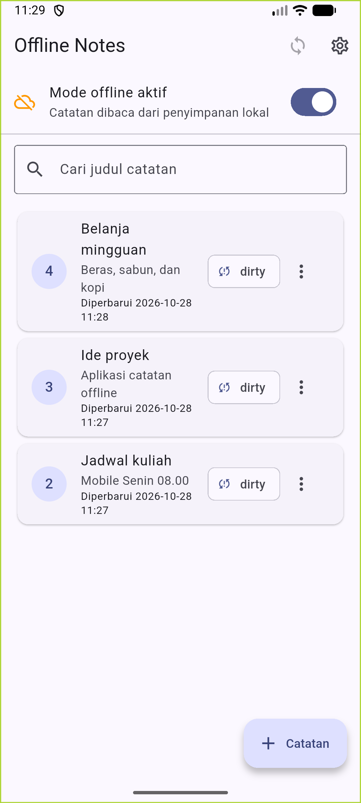
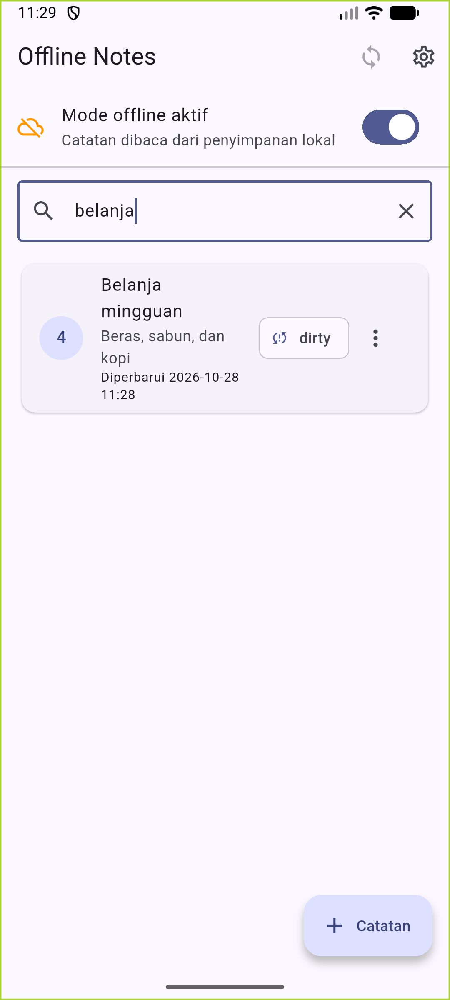
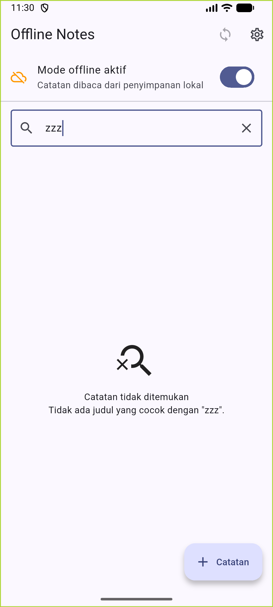

# Week 9 - AI-Assisted Development / Vibe Coding

| Identitas Mahasiswa | Keterangan |
|---|---|
| **Nama** | Fikar Bahrul Santoso |
| **NIM** | 244107020160 |
| **Mata Kuliah** | Pemrograman Mobile |

## Tentang Project

Minggu ini tidak membuat project baru. Project Offline Notes dari Minggu 5–8
dipakai kembali, lalu ditambah **satu fitur kecil**: pencarian judul catatan
beserta empty state ketika hasilnya kosong. AI dipakai untuk mengusulkan kode
dan mereview, tetapi setiap baris tetap dibaca, diverifikasi, diuji, dan
diputuskan sendiri.

Inti pengerjaan bukan banyaknya kode dari AI, melainkan bukti bahwa kode
tersebut benar: analyze bersih, test hijau, dan satu halusinasi AI berhasil
ditemukan lalu diperbaiki.

## Fitur

- Pencarian judul catatan yang mengabaikan huruf besar/kecil
- Query kosong atau hanya spasi menampilkan semua catatan
- Empty state "Catatan tidak ditemukan" saat query tidak cocok
- Tombol hapus pencarian di kolom search
- CRUD catatan offline, mode offline/online, sinkronisasi simulasi
- Tema gelap/terang dan waktu terakhir dibuka
- Cache-first posts JSONPlaceholder

## Stack Teknologi

| Teknologi | Penggunaan |
|---|---|
| Flutter 3.47.2 / Dart 3.13.2 | Framework dan bahasa |
| Riverpod 3.4.3 | State management dan dependency injection |
| sqflite 2.4.4+1 | Penyimpanan catatan dan cache posts |
| shared_preferences 2.5.6 | Tema dan waktu terakhir dibuka |
| Dio 5.11.1 | Refresh posts di background |
| Android - emulator Medium_Phone | Perangkat uji (1080×2400) |

## Struktur Project

```text
09-week-9-ai-assisted-development/
├── README.md
├── docs/
│   ├── ai-log.md                 (prompt, verifikasi, halusinasi, red-green)
│   ├── ai-challenge.md           (prompt, output mentah AI, tabel keputusan)
│   └── evidence/                 (log analyze, test merah, test hijau, format)
├── screenshots/
│   ├── P2_01_query_kosong.png
│   ├── P2_02_query_cocok.png
│   └── P2_03_query_tidak_cocok.png
├── lib/
│   ├── core/
│   └── features/
│       ├── notes/
│       │   ├── domain/usecases/search_notes.dart   (baru)
│       │   ├── presentation/pages/notes_page.dart
│       │   └── presentation/providers/notes_providers.dart
│       ├── posts/
│       └── settings/
└── test/
    ├── search_filter_test.dart     (baru)
    ├── search_widget_test.dart     (baru)
    └── ...test minggu sebelumnya
```

## Menjalankan Project

```bash
cd 09-week-9-ai-assisted-development/
flutter pub get
flutter run
```

Perangkat uji: emulator Medium_Phone (`emulator-5554`). APK release juga sudah
di-build dan dipasang saat pengambilan screenshot.

## Praktikum 1 - Prompt dan Context Engineering

Prompt disusun dengan lima slot: **Peran, Konteks, Tugas, Batas, Output**.
Konteks yang ditempel hanya struktur folder, entity `Note`, kontrak repository,
dan versi package dari `pubspec.yaml`. Token dan secret tidak pernah ditempel.

Prompt lengkap serta contoh konteks ada di [docs/ai-log.md](docs/ai-log.md).
Prompt kabur seperti "buatkan search yang keren" sengaja dihindari karena
hasilnya sulit diuji.

## Praktikum 2 - Generate dan Verifikasi Search

AI mengusulkan `SearchNotes` di layer domain. Verifikasi dilakukan enam
langkah: membaca baris, mengecek import, mengecek API, menjalankan analyze,
menulis test, lalu uji manual. Hasil lenkap ada di
[docs/ai-log.md](docs/ai-log.md).

### Halusinasi yang ditemukan

Draf AI memakai `title.contains(query, caseSensitive: false)`. Parameter
`caseSensitive` tidak ada di Dart. Buktinya dari `flutter analyze`:

```text
error - The named parameter 'caseSensitive' isn't defined.
lib/features/notes/domain/usecases/search_notes.dart:11:53
- undefined_named_parameter
```

Signature asli di Dart SDK:

```text
lib/core/string.dart:500
bool contains(Pattern other, [int startIndex = 0]);
```

Perbaikan: `contains` tetap dipakai, lalu judul dan kata kunci sama-sama
diubah ke huruf kecil dengan `toLowerCase()`.

### Uji manual tiga query

Query kosong menampilkan seluruh catatan:



Query `belanja` cocok dengan judul **Belanja mingguan** meskipun huruf awal
berbeda:



Query `zzz` tidak menemukan apa pun dan memunculkan empty state:



## Praktikum 3 - Debug dan Refactor

Bug logika pada draf AI dibuktikan lebih dulu lewat test merah:

```text
filter abaikan huruf besar/kecil [E]
  Expected: an object with length of <2>
  Actual: has length of <1>

query berisi spasi saja dianggap kosong [E]
  Expected: an object with length of <3>
  Actual: has length of <0>
```

Perbaikan kecil di use case: `query.trim().toLowerCase()`. Setelah itu semua
test hijau. Log mentah ada di
[docs/evidence/test-merah.txt](docs/evidence/test-merah.txt) dan
[docs/evidence/test-hijau.txt](docs/evidence/test-hijau.txt).

Filter dipindah ke `domain/usecases/search_notes.dart` yang murni, tanpa
Flutter, Dio, atau sqflite. Alurnya menjadi:

```text
widget (UI saja)
  -> provider (state query + hasil)
  -> SearchNotes (aturan filter)
  -> repository (SQLite)
```

Widget tidak lagi tahu cara memfilter. Ia hanya menampilkan daftar yang sudah
disaring dan mengirim kata kunci.

## AI Challenge

Prompt review, output mentah review AI, lima temuan, tabel terima/tolak, dan
bukti `grep`/test ada di [docs/ai-challenge.md](docs/ai-challenge.md).
Ringkasnya: **2 temuan diterima**
(query spasi dan pemindahan filter ke domain) dan **3 ditolak** (menggabung
query ke notifier, pencarian SQL per ketikan, dan penambahan package fuzzy
search).

### Penjelasan awam tanpa membuka AI

- **Pencarian itu menyaring, bukan mengambil ulang data.** Semua catatan sudah
  ada di HP. Saat mengetik, aplikasi hanya memilih judul yang memuat kata
  kunci, jadi tidak ada baca database atau internet baru.
- **`trim()` membuang spasi di ujung.** Kalau pengguna hanya mengetik spasi,
  isinya dianggap kosong dan semua catatan tampil.
- **`toLowerCase()` menyamakan huruf besar/kecil.** "Belanja" dan "belanja"
  dianggap sama, sehingga pencarian tidak gagal hanya karena kapitalisasi.
- **Halusinasi AI seperti menu yang tidak ada di restoran.** AI yakin ada
  parameter `caseSensitive`, padahal Dart tidak punya. Buktinya bukan perasaan,
  tetapi `flutter analyze` dan signature asli di SDK.
- **Use case murni memudahkan ujian.** Aturan pencarian tidak butuh HP atau
  tampilan, jadi bisa diuji cepat dan hasilnya pasti.
- **Empty state memberi kepastian.** Saat tidak ada hasil, pengguna tahu
  pencariannya memang nihil, bukan aplikasi rusak atau data hilang.

## Testing

```bash
dart format --set-exit-if-changed .
flutter analyze
flutter test
```

Hasil terakhir:

```text
dart format --set-exit-if-changed .  => 0 file berubah
flutter analyze                      => No issues found!
flutter test                         => All tests passed! (14 test)
```

Test yang ditambahkan minggu ini:

- `search_filter_test.dart` - cocok tanpa peduli huruf besar/kecil, query
  tidak cocok, query kosong, dan query berisi spasi.
- `search_widget_test.dart` - empty state muncul saat query tidak cocok.

## Refleksi

### Satu halusinasi AI dan cara membuktikannya

AI memakai `String.contains(..., caseSensitive: false)`. Saya membuktikannya
dengan `flutter analyze` yang menolak named parameter tersebut, lalu mencocokkan
dengan signature `bool contains(Pattern other, [int startIndex = 0])` di Dart
SDK. Setelah itu kode diperbaiki, bukan dipaksa agar lolos.

### Prompt yang paling membantu dan apa yang diubah

Prompt dengan batas jelas ("jangan ubah arsitektur, maksimal 80 baris, sertakan
tiga test") paling membantu karena hasilnya langsung bisa diperiksa. Yang saya
ubah: menambahkan konteks entity dan kontrak repository, serta menegaskan bahwa
SQLite tidak boleh dipanggil dari widget.

### Satu refactor pada kode AI

Filter dipindah dari calon kode widget ke use case murni `SearchNotes`.
Dampaknya, aturan pencarian bisa diuji tanpa membangun UI dan widget kembali
sederhana.

### Keputusan terima/tolak yang paling sulit

Menolak usulan menggabungkan query ke `NotesNotifier`. Terlihat lebih ringkas,
tetapi akan mencampur kata kunci sementara dengan state data `AsyncValue`.
Saya memilih memisahkan query karena perubahan huruf tidak seharusnya memicu
ulang pemuatan catatan.

## Checklist Verifikasi

- [Berhasil] `flutter analyze` bersih
- [Berhasil] `flutter test` semua lulus (14 test)
- [Berhasil] `dart format --set-exit-if-changed .` tidak mengubah file
- [Berhasil] APK release terinstal dan dijalankan di emulator Medium_Phone
- [Berhasil] Tiga screenshot uji manual ada di `screenshots/`
- [Berhasil] `README.md` di root minggu, link ke docs/screenshot resolve
- [Berhasil] `docs/` berisi `ai-log.md`, `ai-challenge.md`, dan bukti log
- [Berhasil] Output mentah review AI tersimpan di `docs/ai-challenge.md`
- [Berhasil] Minimal 1 halusinasi AI dibuktikan dan diperbaiki
- [Berhasil] Minimal 1 temuan AI ditolak dengan alasan teknis
- [Berhasil] Fitur bisa dijelaskan tanpa membuka AI

## Kesimpulan

Fitur pencarian judul berhasil ditambahkan tanpa mengubah arsitektur Minggu 7.
AI mempercepat pembuatan draf dan menemukan dua kelemahan nyata, tetapi tetap
ada satu halusinasi API yang harus dibuktikan lewat analyze dan signature SDK.
Setelah filter dipindah ke use case murni, aturan pencarian menjadi mudah
diuji, widget tetap bersih, dan seluruh test hijau. Pengalaman ini menunjukkan
bahwa nilai AI bukan pada banyaknya kode yang dihasilkan, melainkan pada
kualitas verifikasi dan keputusan yang bisa dipertanggungjawabkan.