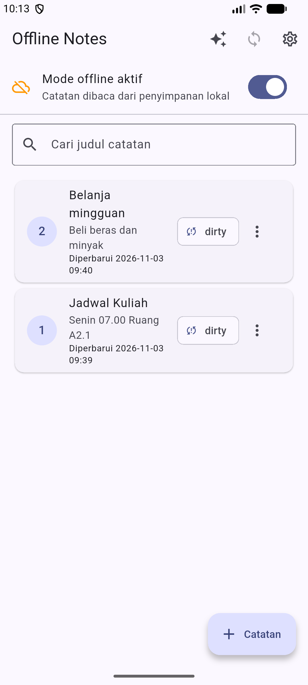
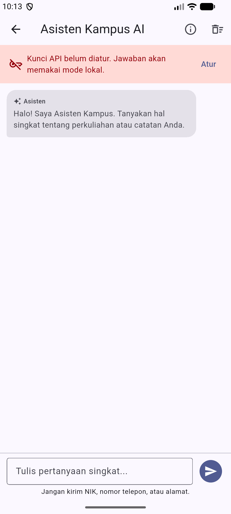
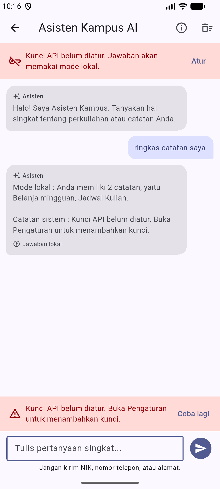
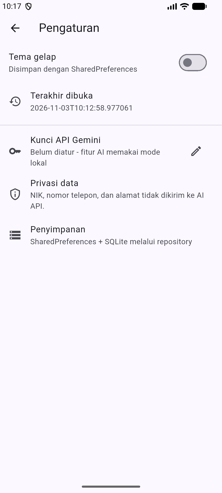
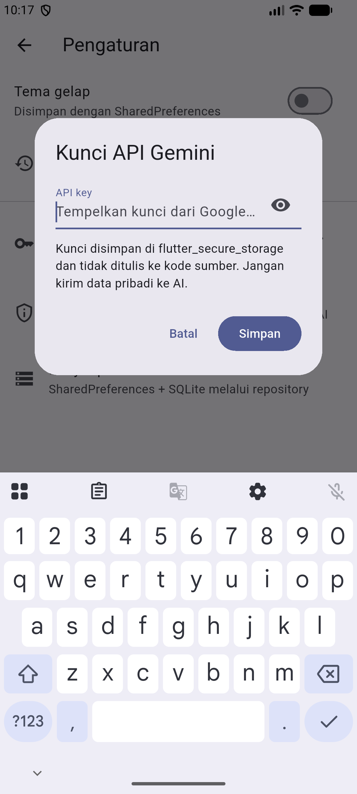
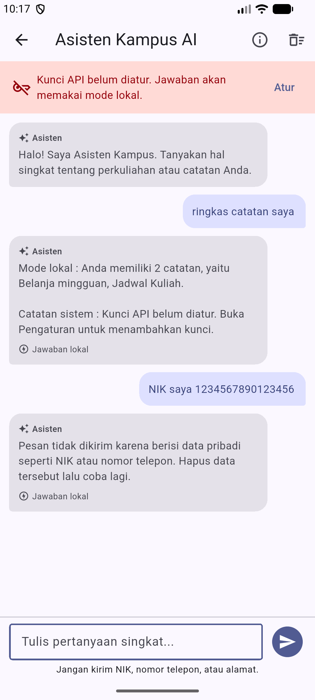
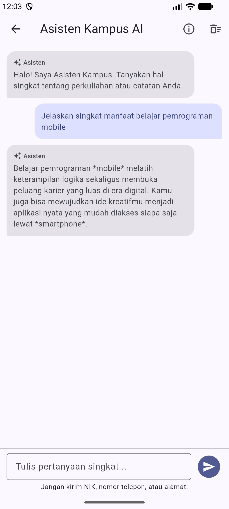
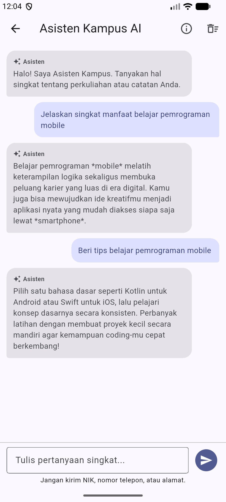
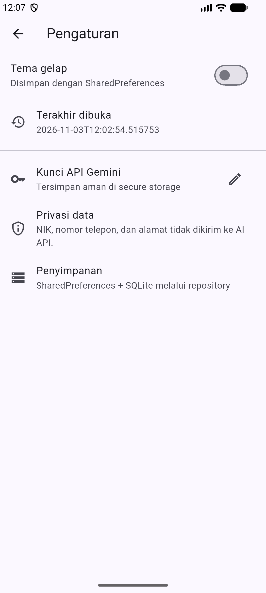

# Week 10 - Integrasi Fitur AI

| Identitas Mahasiswa | Keterangan |
|---|---|
| **Nama** | Fikar Bahrul Santoso |
| **NIM** | 244107020160 |
| **Mata Kuliah** | Pemrograman Mobile |

## Tentang Project

Minggu ini tidak membuat project baru. Project Offline Notes dari Minggu 5-9
dipakai kembali, lalu ditambah satu fitur AI, yaitu **Chat Asisten Kampus**.
Fitur ini memakai Google Gemini REST dengan streaming response, kunci API yang
disimpan di `flutter_secure_storage`, pencegahan data pribadi, dan fallback ke
data catatan lokal ketika layanan AI tidak tersedia.

Fokus pengerjaan bukan banyaknya kode AI, tetapi bukti bahwa fitur aman,
teruji, dan tetap bisa dipakai saat API gagal.

## Fitur

- Chat asisten kampus dengan streaming response dan indikator "Mengetik..."
- Kunci API Gemini disimpan aman di `flutter_secure_storage`, bukan di kode
- Pencegahan NIK 16 digit dan nomor telepon sebelum dikirim ke AI
- Fallback lokal yang merangkum judul catatan saat kunci kosong atau API error
- Pesan error ramah, tombol **Coba lagi**, dan label **Jawaban lokal**
- System prompt singkat, maksimal dua kalimat, dan `maxOutputTokens : 256`
- CRUD catatan offline, pencarian judul, mode offline/online, tema gelap
- Cache-first posts JSONPlaceholder dari minggu sebelumnya

## Stack Teknologi

| Teknologi | Penggunaan |
|---|---|
| Flutter 3.47.2 / Dart 3.13.2 | Framework dan bahasa |
| Riverpod 3.4.3 | State management dan dependency injection |
| http 1.6.0 | Request Gemini REST dan pembacaan SSE |
| flutter_secure_storage 11.2.0 | Penyimpanan kunci API |
| sqflite 2.4.4+1 | Penyimpanan catatan dan cache posts |
| shared_preferences 2.5.6 | Tema dan waktu terakhir dibuka |
| Dio 5.11.1 | Refresh posts di background |
| Android - emulator Medium_Phone | Perangkat uji (1080x2400) |

## Struktur Project

```text
10-week-10-ai-feature-integration/
├── README.md
├── docs/
│   ├── ai-log.md                 (prompt, output awal, uji live, verifikasi)
│   └── evidence/
│       ├── analyze.txt
│       ├── build-apk.txt
│       ├── format.txt
│       ├── live-gemini.txt
│       └── test.txt
├── screenshots/
│   ├── P1_01_notes_ai_button.png
│   ├── P1_02_chat_belum_ada_key.png
│   ├── P1_03_chat_fallback_lokal.png
│   ├── P1_04_settings_ai.png
│   ├── P1_05_dialog_api_key.png
│   ├── P1_06_chat_privasi_nik.png
│   ├── P1_07_chat_live_gemini.png
│   ├── P1_08_chat_live_tips.png
│   └── P1_09_settings_key_aktif.png
├── lib/
│   ├── ai/
│   │   ├── ai_providers.dart
│   │   ├── ai_service.dart
│   │   ├── ai_service_provider.dart
│   │   ├── chat_notifier.dart
│   │   ├── chat_state.dart
│   │   ├── local_fallback.dart
│   │   └── privacy_guard.dart
│   ├── features/
│   │   ├── chat_screen.dart
│   │   ├── notes/
│   │   └── settings/
│   │       └── presentation/widgets/ai_key_tile.dart
│   ├── main.dart
│   └── routes.dart
└── test/
    ├── chat_notifier_test.dart
    ├── chat_widget_test.dart
    ├── local_fallback_test.dart
    ├── privacy_guard_test.dart
    └── ...test minggu sebelumnya
```

## Menjalankan Project

```bash
cd 10-week-10-ai-feature-integration/
flutter pub get
flutter run
```

Perangkat uji: emulator Medium_Phone (`emulator-5554`). APK release sudah
di-build dan dipasang saat pengambilan screenshot.

Untuk mengaktifkan jawaban AI live, buka **Pengaturan > Kunci API Gemini**,
tempelkan kunci dari Google AI Studio, lalu simpan. Tanpa kunci, aplikasi tetap
berjalan dengan fallback lokal.

## Praktikum 1 - Konsep Integrasi Fitur AI

Alur fitur:

```text
ChatScreen (UI)
  -> chatProvider (state percakapan)
  -> AiService (HTTP + SSE)
  -> Gemini API

Jika gagal:
  -> chatProvider
  -> LocalFallback (judul catatan dari repository)
```

Aturan yang diterapkan:

- Widget tidak memanggil HTTP atau SQLite langsung.
- Kunci API tidak pernah ditulis di kode sumber.
- Hanya pertanyaan terbaru yang dikirim untuk menghemat biaya.
- Data pribadi dicek sebelum request dibuat.
- Respons API divalidasi sebelum ditampilkan.

Detail prompt, output awal AI, dan verifikasi ada di
[docs/ai-log.md](docs/ai-log.md).

## Praktikum 2 - Chat Interface dengan AI

Implementasi utama:

- `lib/ai/ai_service.dart` berisi `AiService`, endpoint Gemini
  `gemini-3.5-flash-lite`, pembacaan SSE, penyimpanan kunci, dan pemetaan error.
- `lib/ai/chat_notifier.dart` mengelola pesan, status mengirim, error, dan
  fallback.
- `lib/features/chat_screen.dart` menampilkan bubble chat, banner kunci,
  indikator mengetik, tombol kirim, dan tombol coba lagi.
- `lib/features/settings/presentation/widgets/ai_key_tile.dart` mengatur kunci
  API dengan input tersembunyi.
- Tombol **Asisten AI** ditambahkan di app bar halaman catatan.

Contoh potongan alur streaming:

```dart
await for (final chunk in service.askStream(question)) {
  buffer.write(chunk);
  _replaceLastAssistant(buffer.toString(), local: false);
}
```

### Bukti tampilan

Halaman catatan dengan tombol Asisten AI:



Chat saat kunci API belum diatur:



Fallback lokal merangkum dua catatan:



Pengaturan kunci API:



Dialog kunci API dengan input tersembunyi:



Data pribadi diblokir sebelum dikirim:



Jawaban live dari Gemini (`gemini-3.5-flash-lite`) pada APK release:



Contoh jawaban live kedua dengan topik berbeda:



Kunci API sudah tersimpan dan fitur AI aktif:



## Praktikum 3 - OCR, Speech-to-Text, dan Image Understanding

Codelab membahas tiga fitur tambahan, tetapi tugas meminta **satu fitur AI**
saja. Saya memilih chat karena paling sesuai dengan data catatan dan bisa diuji
tanpa kamera atau mikrofon. OCR, Speech-to-Text, dan Image Understanding tidak
ditambahkan agar pekerjaan tetap fokus dan tidak ada fitur di luar instruksi.

## Privasi, Biaya, Error Handling, dan Fallback

| Risiko | Mitigasi |
|---|---|
| Data pribadi bocor | NIK dan nomor telepon diblokir sebelum request, system prompt melarang meminta data pribadi, tidak ada logging isi chat |
| Kunci API dicuri | Disimpan di `flutter_secure_storage`, input disamarkan, tidak ditulis ke repo |
| Biaya melonjak | Hanya pertanyaan terbaru dikirim, `maxOutputTokens : 256`, tidak ada auto-retry berulang, fallback lokal |
| API error atau down | Pesan ramah, tombol **Coba lagi**, fallback lokal, tidak crash |
| Rate limit | Kode 429 dipetakan ke pesan "tunggu sebentar", tidak melakukan loop request |
| Respons tidak relevan | System prompt membatasi dua kalimat, hasil tetap bisa dibaca dan fallback tersedia |

Contoh pemetaan error:

```text
400/401/403 -> Kunci API tidak valid atau tidak punya akses
429         -> Batas permintaan AI tercapai
5xx         -> Layanan AI sedang sibuk
tanpa kunci -> Mode lokal
```

## Testing

```bash
dart format --output=none --set-exit-if-changed lib test
flutter analyze
flutter test
```

Hasil terakhir:

```text
dart format --output=none --set-exit-if-changed lib test  => 0 file berubah
flutter analyze                                           => No issues found
flutter test                                              => 27 test lulus
```

Bukti mentah:

- [docs/evidence/format.txt](docs/evidence/format.txt)
- [docs/evidence/analyze.txt](docs/evidence/analyze.txt)
- [docs/evidence/test.txt](docs/evidence/test.txt)
- [docs/evidence/build-apk.txt](docs/evidence/build-apk.txt)
- [docs/evidence/live-gemini.txt](docs/evidence/live-gemini.txt)

Test baru minggu ini:

- `chat_notifier_test.dart` - streaming, fallback tanpa kunci, error API,
  blokir data pribadi, dan clear percakapan.
- `chat_widget_test.dart` - banner kunci, fallback lokal, dan jawaban streaming.
- `privacy_guard_test.dart` - NIK, nomor telepon, dan pertanyaan biasa.
- `local_fallback_test.dart` - ringkasan catatan, catatan kosong, dan mode lokal.

## Refleksi

### Fitur AI yang dipilih dan alasannya

Saya memilih chat asisten karena cocok dengan project catatan dan tidak
memerlukan izin kamera atau mikrofon. Fitur ini juga memaksa saya memikirkan
streaming, keamanan kunci, dan fallback, bukan hanya menampilkan satu tombol AI.

### Cara melindungi privasi pengguna

Kunci API disimpan di secure storage dan tidak pernah masuk kode sumber. Sebelum
request, teks dicek dengan pola NIK 16 digit dan nomor telepon Indonesia. System
prompt juga melarang meminta data pribadi, dan hanya pertanyaan terbaru yang
dikirim ke API.

### Fallback jika layanan AI error

Jika kunci belum diatur atau API gagal, aplikasi menampilkan pesan ramah dan
menggunakan jawaban lokal dari judul catatan. Pengguna tetap mendapat informasi,
tetapi diberi label **Jawaban lokal** agar tidak mengira itu jawaban AI.

### Satu hal yang dipelajari tentang UX fitur AI di mobile

Indikator status sangat penting. Pengguna perlu tahu apakah aplikasi sedang
menunggu AI, gagal, atau memakai mode lokal. Karena itu ada indikator
"Mengetik...", banner kunci, pesan error, tombol coba lagi, dan label jawaban
lokal.

## Catatan Pengujian Live

Uji live Gemini sudah dilakukan pada APK release di emulator Medium_Phone.
Kunci diisi lewat Pengaturan, lalu pertanyaan dikirim dari halaman Asisten
Kampus AI. Server membalas `HTTP 200` dengan streaming SSE dan jawaban tampil
tanpa label "Jawaban lokal" (lihat `P1_07` dan `P1_08`).

Model akhir yang dipakai adalah `gemini-3.5-flash-lite`. Model
`gemini-flash-latest` sempat dibalas `503 UNAVAILABLE` karena permintaan tinggi,
dan `gemini-2.5-flash-lite` dibalas `404 NOT_FOUND` karena sudah tidak tersedia.
Varian lite terbaru dipilih karena paling ringan dan responsif.

Ditemukan juga satu bug build release: `android.permission.INTERNET` hanya ada
di manifest debug/profile. Izin tersebut ditambahkan ke
`android/app/src/main/AndroidManifest.xml`, lalu APK di-build ulang dan diuji.
Kunci tidak pernah ditulis ke repo maupun log.

## Checklist Verifikasi

- [Berhasil] `flutter analyze` bersih
- [Berhasil] `flutter test` semua lulus (27 test)
- [Berhasil] `dart format --set-exit-if-changed` tidak mengubah file
- [Berhasil] APK release terinstal dan dijalankan di emulator Medium_Phone
- [Berhasil] Uji live Gemini `HTTP 200` dengan streaming SSE di APK release
- [Berhasil] Sembilan screenshot alur AI ada di `screenshots/`
- [Berhasil] `README.md` di root minggu, link ke docs dan screenshot resolve
- [Berhasil] `docs/ai-log.md` berisi system prompt, user prompt, dan output awal
- [Berhasil] `docs/evidence/` berisi log format, analyze, test, build, dan live Gemini
- [Berhasil] Tidak ada kunci API, token, atau secret di project