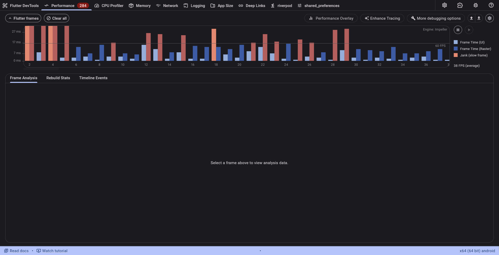
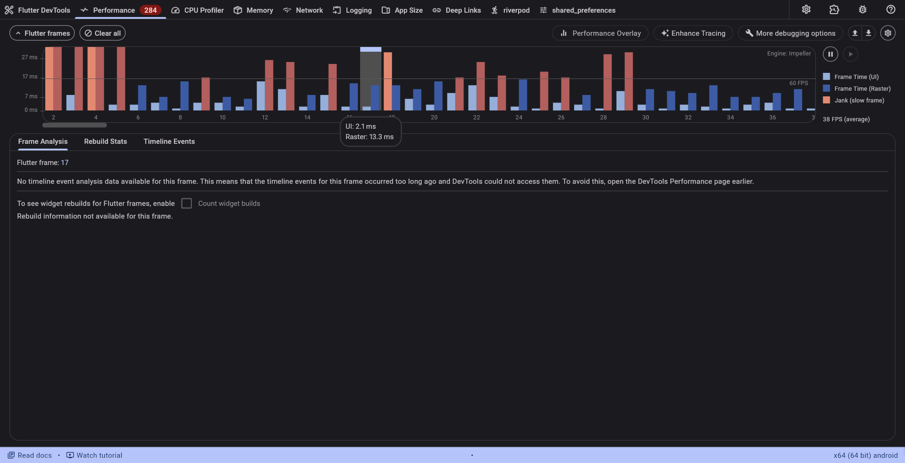
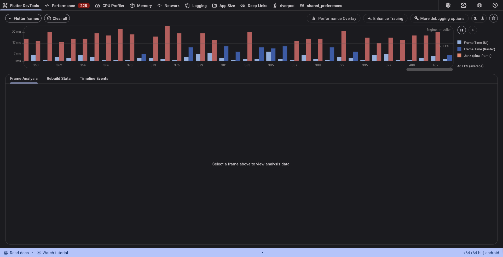
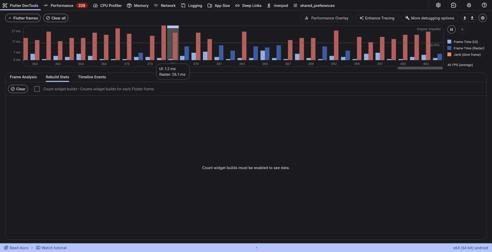
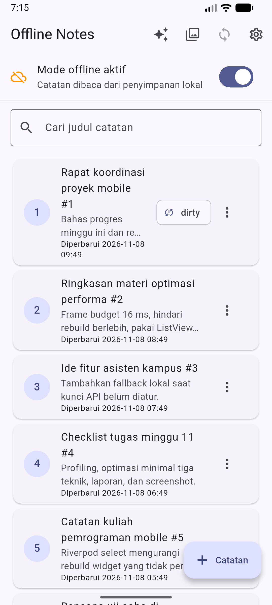
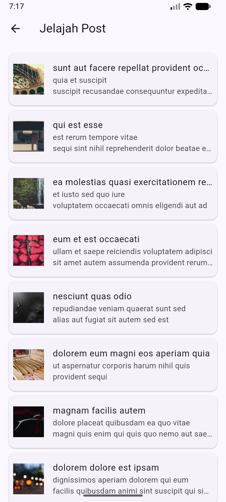
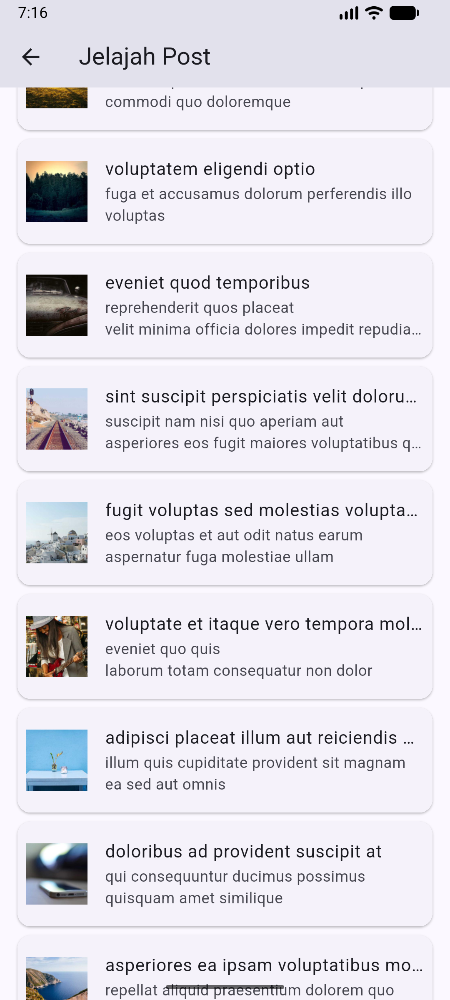
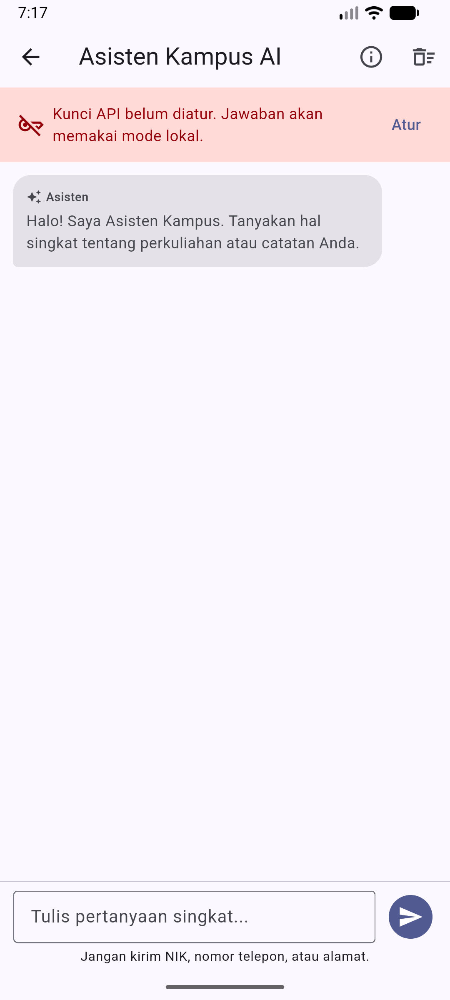
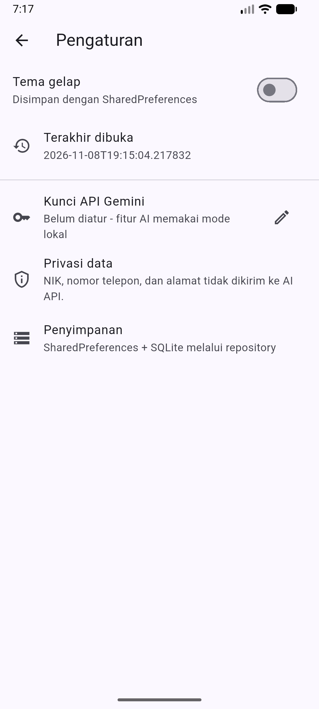

# Week 11 - Optimasi Performa

| Identitas Mahasiswa | Keterangan |
|---|---|
| **Nama** | Fikar Bahrul Santoso |
| **NIM** | 244107020160 |
| **Mata Kuliah** | Pemrograman Mobile |

## Tentang Project

Minggu ini tidak membuat project baru. Project Offline Notes dari Minggu 10
dipakai kembali, lalu dioptimalkan performanya. Fokus pekerjaan ada pada
pengukuran dengan Flutter DevTools, pengurangan rebuild, isolasi paint,
lazy loading dan pagination, optimasi gambar, serta cache repository.

Optimasi yang diterapkan lebih dari tiga teknik yang diminta, yaitu
`Riverpod select`, ekstrak widget dan `const`, `RepaintBoundary`,
`ListView.builder` dengan pagination, `CachedNetworkImage`, dan cache
repository network-first.

## Fitur

- CRUD catatan offline, pencarian judul, mode offline/online, dan tema gelap
- Chat Asisten Kampus dengan fallback lokal dari Minggu 10
- Halaman **Jelajah Post** dengan pagination 10 item per halaman
- Gambar post memakai `CachedNetworkImage` dengan batas ukuran memori
- Cache post di SQLite dan fallback ketika jaringan gagal
- Bukti profiling DevTools sebelum dan sesudah optimasi

## Stack Teknologi

| Teknologi | Penggunaan |
|---|---|
| Flutter 3.47.2 / Dart 3.13.2 | Framework dan bahasa |
| Riverpod 3.4.3 | State management dan dependency injection |
| cached_network_image 4.0.6 | Cache gambar jaringan dan batas decode |
| Dio 5.11.1 | Request API posts dan halaman pagination |
| sqflite 2.4.4+1 | Catatan dan cache posts |
| shared_preferences 2.5.6 | Tema dan waktu terakhir dibuka |
| http 1.6.0 | Request Gemini dari Minggu 10 |
| flutter_secure_storage 11.2.0 | Penyimpanan kunci API |
| Android - emulator Medium_Phone | Perangkat uji (1080 x 2400) |

## Struktur Project

```text
11-week-11-performance-optimization/
├── README.md
├── docs/
│   ├── performance-findings.md
│   ├── performance-report.md
│   └── evidence/
│       ├── analyze.txt
│       ├── build-apk.txt
│       ├── format.txt
│       └── test.txt
├── screenshots/
│   ├── W11_01_notes_list.png
│   ├── W11_02_posts_page.png
│   ├── W11_03_posts_pagination.png
│   ├── W11_04_chat.png
│   ├── W11_05_settings.png
│   ├── before-profile.png
│   ├── before-frame-detail.png
│   ├── after-profile.png
│   └── after-frame-detail.png
├── lib/
│   ├── features/posts/presentation/pages/posts_page.dart   (baru)
│   ├── features/posts/data/repositories/post_repository_impl.dart
│   ├── features/notes/presentation/pages/notes_page.dart
│   ├── features/chat_screen.dart
│   ├── main.dart
│   └── ...kode Minggu 10
└── test/
    └── ...27 test Minggu 10
```

## Menjalankan Project

```bash
cd 11-week-11-performance-optimization/
flutter pub get
flutter run
```

Untuk profiling:

```bash
flutter run --profile -d emulator-5554
```

## Praktikum 1 - Baseline Profiling

Langkah yang dilakukan:

1. Menjalankan project Minggu 10 dengan `flutter run --profile`.
2. Membuka DevTools tab **Performance**.
3. Mengisi database dengan 60 catatan.
4. Merekam skenario scroll 10 kali ke bawah dan 10 kali ke atas.
5. Menyimpan screenshot frame chart.

Hasil baseline: 38 FPS rata-rata, 284 frame jank, dan frame contoh dengan
UI 2.1 ms serta Raster 13.3 ms.





## Praktikum 2 - Identifikasi Masalah

Temuan utama:

1. Widget ikut rebuild karena `ref.watch` membaca seluruh `AsyncValue`.
2. Paint berulang pada item daftar dan bubble chat.
3. Halaman post belum memakai pagination.
4. Gambar jaringan diambil ukuran penuh tanpa cache.
5. Request post berulang tanpa fallback cache.

Detail temuan ada di [docs/performance-findings.md](docs/performance-findings.md).

## Praktikum 3 - Optimasi

| Optimasi | Lokasi | Alasan |
|---|---|---|
| `Riverpod select` | `main.dart`, `notes_page.dart`, `chat_screen.dart` | Widget hanya rebuild saat nilai yang dipakai berubah |
| Ekstrak widget dan `const` | `notes_page.dart`, `posts_page.dart` | Mengurangi cakupan rebuild dan memudahkan `const` |
| `RepaintBoundary` | Daftar catatan, bubble chat, daftar post | Hanya item yang berubah yang digambar ulang |
| `ListView.builder` + pagination | `posts_page.dart`, `post_repository_impl.dart` | Item dibangun saat terlihat, data diambil 10 per halaman |
| `CachedNetworkImage` | `PostTile` | Gambar di-cache dan decode dibatasi 168 piksel |
| Cache repository | `post_repository_impl.dart` | Network-first, simpan ke `cached_posts`, fallback offline |

## Praktikum 4 - Verifikasi Profiling

Skenario yang sama diulang pada project Minggu 11.

| Metrik | Baseline Week 10 | Setelah Optimasi |
|---|---|---|
| FPS rata-rata | 38 FPS | 40 FPS |
| Frame jank | 284 | 228 |
| Waktu UI contoh | 2.1 ms | 1.2 ms |
| Waktu Raster contoh | 13.3 ms | 26.1 ms |





Catatan : nilai Raster pada emulator naik turun karena renderer software.
Perbandingan UI dan Raster bersifat indikatif, sedangkan arah perbaikan
(jank turun dan FPS naik) konsisten. Uraian lengkap ada di
[docs/performance-report.md](docs/performance-report.md).

## Praktikum 5 - Pemeriksaan Memori

Pemeriksaan dilakukan dengan meninjau siklus hidup controller dan listener :

- `_searchController` pada `NotesPage` di-dispose.
- `_inputController` dan `_scrollController` pada `ChatScreen` di-dispose.
- `_scrollController` pada `PostsPage` di-dispose dan listener ikut dilepas.
- Tidak ada stream subscription manual yang dibiarkan terbuka.

Dari peninjauan kode, tidak ditemukan controller atau listener yang menumpuk
saat navigasi berulang.

## Bukti Tampilan Aplikasi

Daftar catatan dengan 60 data uji :



Halaman Jelajah Post dengan gambar dari cache :



Pagination saat scroll ke bawah :



Chat Asisten Kampus :



Pengaturan :



## Testing

```bash
dart format --output=none --set-exit-if-changed lib test
flutter analyze
flutter test
```

Hasil terakhir:

```text
dart format --output=none --set-exit-if-changed lib test  => 0 file berubah
flutter analyze                                           => No issues found
flutter test                                              => 27 test lulus
flutter build apk --release                               => app-release.apk 51.8 MB
```

Bukti mentah :

- [docs/evidence/format.txt](docs/evidence/format.txt)
- [docs/evidence/analyze.txt](docs/evidence/analyze.txt)
- [docs/evidence/test.txt](docs/evidence/test.txt)
- [docs/evidence/build-apk.txt](docs/evidence/build-apk.txt)

## Refleksi

### Optimasi dengan dampak terbesar

Pagination dan `CachedNetworkImage` memberi dampak paling terasa pada halaman
post. Sebelumnya semua data dan gambar dimuat sekaligus. Setelah dibatasi 10
item per halaman dan decode gambar dibatasi, Raster Thread tidak lagi memproses
gambar ukuran penuh berulang kali.

### Cara memverifikasi optimasi

Verifikasi dilakukan dengan DevTools pada mode profile, bukan dengan asumsi.
Skenario scroll dibuat sama untuk baseline dan hasil optimasi. Angka FPS,
jumlah jank, dan waktu UI/Raster dibandingkan. Perubahan kode yang tidak
terukur tidak diklaim sebagai perbaikan.

### Trade-off yang dihadapi

Pagination menambah state (`_page`, `_isLoading`, `_hasMore`) dan controller
baru. Cache repository menambah penulisan ke SQLite. Keduanya menambah
kompleksitas, tetapi diperlukan agar daftar panjang dan gambar jaringan tetap
ringan.

### Kapan optimasi prematur dihindari

Untuk daftar pendek dan data lokal, `ListView.builder` yang sederhana sudah
cukup. Optimasi sebaiknya dilakukan setelah profiling menunjukkan masalah nyata,
bukan karena ingin memakai teknik yang terlihat canggih.

## Checklist Verifikasi

- [Berhasil] `flutter analyze` bersih
- [Berhasil] `flutter test` semua lulus (27 test)
- [Berhasil] `dart format --set-exit-if-changed` tidak mengubah file
- [Berhasil] APK release dibangun dan dipasang di emulator Medium_Phone
- [Berhasil] Minimal tiga optimasi diterapkan (enam teknik)
- [Berhasil] Profiling before/after dengan skenario sama tersimpan
- [Berhasil] `docs/performance-findings.md` dan `docs/performance-report.md` ada
- [Berhasil] Screenshot aplikasi dan profil ada di `screenshots/`
- [Berhasil] `README.md` di root minggu, link screenshot dan docs resolve
- [Berhasil] `docs/evidence/` berisi log format, analyze, test, dan build