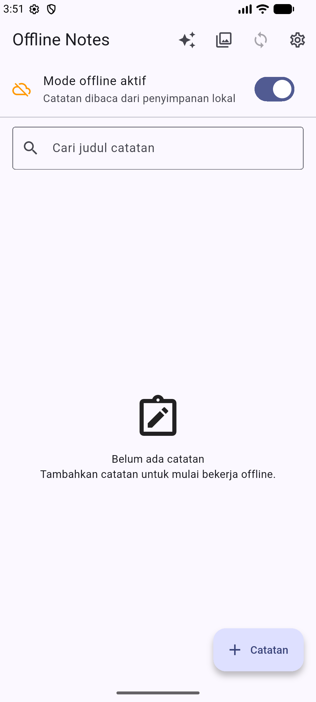
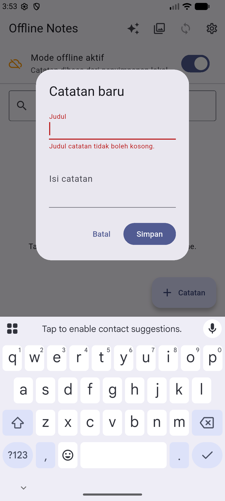
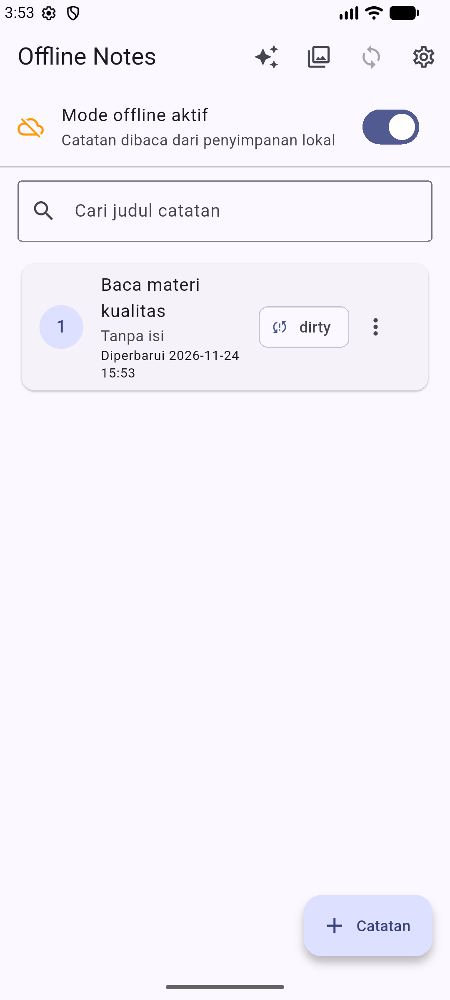
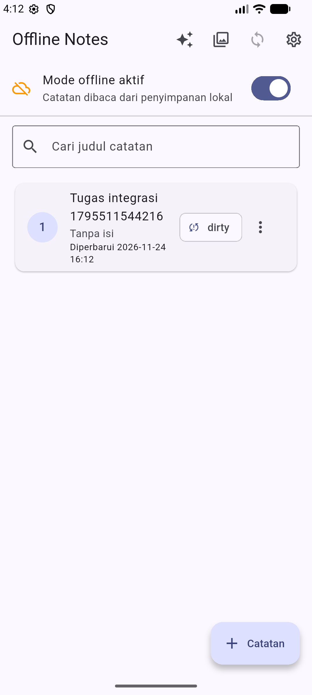

# Week 12 - Pengujian dan Jaminan Kualitas

| Identitas Mahasiswa | Keterangan |
|---|---|
| **Nama** | Fikar Bahrul Santoso |
| **NIM** | 244107020160 |
| **Mata Kuliah** | Pemrograman Mobile |

## Tentang Project

Minggu ini tidak membuat fitur baru. Project Offline Notes dari Minggu 11
dipakai kembali, lalu dilengkapi rangkaian pengujian. Fokus pekerjaan ada pada
pengujian unit beserta kasus tepi, pemisahan dependensi memakai fake repository,
pengujian widget untuk tampilan dan interaksi, serta satu pengujian integrasi
untuk alur utama.

Selain menambah pengujian, ditemukan satu bug pada dialog catatan. Bug tersebut
muncul saat pengujian widget dijalankan dan sudah diperbaiki. Perbaikannya
dictatat pada bagian temuan di bawah.

## Fitur

- CRUD catatan offline dengan pencarian judul
- Mode offline/online dan simulasi sinkronisasi
- Pengaturan tema gelap dan waktu terakhir dibuka
- Pengujian unit validasi judul beserta kasus tepi
- Pengujian unit asinkron untuk `SyncNotes` dengan fake repository
- Pengujian widget untuk empty state, input tidak valid, dan simpan berhasil
- Pengujian integrasi alur tambah catatan pada emulator

## Stack Teknologi

| Teknologi | Penggunaan |
|---|---|
| Flutter 3.47.2 / Dart 3.13.2 | Framework dan bahasa |
| Riverpod 3.4.3 | State management dan dependency injection |
| sqflite 2.4.4+1 | Penyimpanan catatan |
| shared_preferences 2.5.6 | Tema dan waktu terakhir dibuka |
| flutter_test | Pengujian unit dan widget |
| integration_test | Pengujian alur pada perangkat |
| Android - emulator Medium_Phone | Perangkat uji (1080 x 2400) |

## Struktur Project

```text
12-week-12-testing-quality-assurance/
├── README.md
├── docs/
│   ├── testing-scenarios.md
│   └── evidence/
│       ├── analyze.txt
│       ├── build-apk.txt
│       ├── format.txt
│       ├── integration-test.txt
│       └── test.txt
├── screenshots/
│   ├── P1_01_catatan_kosong.png
│   ├── P1_02_error_judul_kosong.png
│   ├── P1_03_catatan_tersimpan.png
│   └── P1_04_hasil_integrasi.png
├── integration_test/
│   └── app_test.dart
├── test/
│   ├── validate_note_edge_cases_test.dart
│   ├── sync_notes_test.dart
│   ├── notes_widget_test.dart
│   └── ...pengujian Minggu 10 dan 11
└── lib/
    └── ...kode Minggu 11
```

## Menjalankan Project

```bash
cd 12-week-12-testing-quality-assurance/
flutter pub get
flutter run
```

## Praktikum 1 - Strategi Pengujian

Bagian aplikasi yang diuji dipilih berdasarkan perilaku penting bagi pengguna,
bukan berdasarkan jumlah baris kode.

| Jenis | Yang diperiksa | Berkas |
|---|---|---|
| Unit | Aturan validasi judul catatan | `test/validate_note_edge_cases_test.dart` |
| Unit asinkron | Use case sinkronisasi dengan fake repository | `test/sync_notes_test.dart` |
| Widget | Empty state, input tidak valid, simpan berhasil | `test/notes_widget_test.dart` |
| Integrasi | Alur tambah catatan pada emulator | `integration_test/app_test.dart` |

Kode sudah memisahkan tanggung jawab melalui `NoteRepository`. Widget tidak
membuka SQLite langsung, sehingga repository dapat diganti fake saat pengujian.

## Praktikum 2 - Pengujian Unit dan Kasus Tepi

Validasi judul memakai fungsi murni di `lib/core/validate.dart` :

```dart
String? validateNoteTitle(String title) {
  if (title.trim().isEmpty) {
    return 'Judul catatan tidak boleh kosong.';
  }
  return null;
}
```

Pengujian dikelompokkan dengan `group` dan memakai pola Arrange, Act, Assert.
Kasus tepi yang diuji adalah teks kosong, spasi saja, serta tab dan baris baru.

```dart
group('validateNoteTitle', () {
  test('menerima judul yang berisi teks', () {
    expect(validateNoteTitle('Belajar Flutter'), isNull);
  });

  test('menolak teks yang hanya berisi tab dan baris baru', () {
    expect(validateNoteTitle('\t\n'), isNotNull);
  });
});
```

## Praktikum 3 - Kode Asinkron dan Dependensi

`SyncNotes` diuji tanpa SQLite asli. Kontrak `NoteRepository` diganti dengan
`FakeSyncRepository` yang nilainya diatur langsung oleh pengujian.

```dart
class FakeSyncRepository implements NoteRepository {
  FakeSyncRepository({this.dirty = 0, this.countFailure, this.markFailure});

  final int dirty;
  final Failure? countFailure;
  final Failure? markFailure;
  bool marked = false;

  @override
  Future<({int count, Failure? failure})> countDirty() async {
    return (count: dirty, failure: countFailure);
  }

  @override
  Future<({bool ok, Failure? failure})> markAllSynced() async {
    if (markFailure != null) {
      return (ok: false, failure: markFailure);
    }
    marked = true;
    return (ok: true, failure: null);
  }
}
```

Skenario yang diperiksa :

1. Antrean berisi tiga catatan, semuanya ditandai tersinkron.
2. Antrean kosong, tidak ada penandaan.
3. Gagal menghitung antrean, failure diteruskan dan antrean tidak ditandai.

## Praktikum 4 - Pengujian Widget

`NotesPage` dirender dengan `ProviderScope` yang mengganti
`noteRepositoryProvider` memakai `FakeNotesRepository`. Dialog diberi `Key`
agar pencarian widget tidak bergantung pada teks yang mudah berubah.

```dart
await tester.tap(find.byKey(const Key('add-note-fab')));
await tester.pumpAndSettle();

await tester.enterText(
  find.byKey(const Key('note-title-field')),
  'Baca materi',
);
await tester.tap(find.byKey(const Key('save-note-button')));
await tester.pumpAndSettle();

expect(find.text('Baca materi'), findsOneWidget);
```

Tiga keadaan diuji, yaitu empty state, pesan error saat judul tidak valid, dan
catatan yang berhasil ditambahkan.

## Praktikum 5 - Pengujian Integrasi

Pengujian integrasi berada di `integration_test/app_test.dart`. Aplikasi asli
dijalankan pada emulator, lalu pengguna menambahkan catatan lewat FAB dan
dialog. Judul diberi penanda waktu agar tidak bentrok dengan data sebelumnya.

```dart
IntegrationTestWidgetsFlutterBinding.ensureInitialized();

testWidgets('pengguna dapat menambahkan catatan baru', (tester) async {
  app.main();
  await tester.pumpAndSettle();

  final title = 'Tugas integrasi ${DateTime.now().millisecondsSinceEpoch}';

  await tester.tap(find.byKey(const Key('add-note-fab')));
  await tester.pumpAndSettle();
  await tester.enterText(find.byKey(const Key('note-title-field')), title);
  await tester.tap(find.byKey(const Key('save-note-button')));
  await tester.pumpAndSettle();

  expect(find.text(title), findsOneWidget);
});
```

Perintah yang dipakai :

```bash
flutter test integration_test/app_test.dart -d emulator-5554
```

## Praktikum 6 - Temuan dan Perbaikan Bug

Saat pengujian widget alur simpan dijalankan, muncul kegagalan berikut :

```text
A TextEditingController was used after being disposed.
```

Masalah : `TextEditingController` pada dialog di-dispose langsung setelah
`showDialog` selesai, padahal dialog masih menjalankan animasi keluar.

Perbaikan : controller dipindahkan ke widget `_NoteEditorDialog` yang
mengelola siklus hidupnya sendiri. Controller baru di-dispose pada `dispose`
setelah dialog dilepas.

Hasil : pengujian widget alur simpan berhasil dan dialog tidak lagi memakai
controller yang sudah di-dispose.

## Hasil Pengujian

```text
dart format --output=none --set-exit-if-changed lib test integration_test  => 0 file berubah
flutter analyze                                                           => No issues found
flutter test                                                              => 38 test lulus
flutter test integration_test/app_test.dart -d emulator-5554              => 1 test lulus
flutter build apk --release                                               => app-release.apk 51.8 MB
```

Bukti mentah :

- [docs/evidence/format.txt](docs/evidence/format.txt)
- [docs/evidence/analyze.txt](docs/evidence/analyze.txt)
- [docs/evidence/test.txt](docs/evidence/test.txt)
- [docs/evidence/integration-test.txt](docs/evidence/integration-test.txt)
- [docs/evidence/build-apk.txt](docs/evidence/build-apk.txt)

Skenario lengkap ada di [docs/testing-scenarios.md](docs/testing-scenarios.md).

## Bukti Tampilan Aplikasi

Keadaan awal tanpa catatan :



Pesan error saat judul tidak diisi :



Catatan berhasil ditambahkan :



Catatan yang dibuat oleh pengujian integrasi pada emulator :



## Refleksi

### Bug yang paling mungkin terlewat

Bug controller dialog di-dispose terlalu cepat sulit terlihat saat mencoba
aplikasi secara manual karena dialog biasanya sudah tertutup. Pengujian widget
yang memeriksa hasil setelah dialog ditutup langsung menemukan bug ini.

### Bagian yang memerlukan fake

`SyncNotes` memerlukan fake karena bergantung pada repository. Dengan fake,
kondisi antrean kosong dan kegagalan dapat diuji tanpa menyentuh SQLite asli.
Hasilnya pengujian lebih cepat dan konsisten.

### Nilai pengujian widget dan integrasi

Pengujian widget memeriksa tampilan serta interaksi tanpa perangkat, sehingga
cocok untuk keadaan error dan empty state. Pengujian integrasi memastikan alur
dari FAB sampai daftar benar-benar berjalan pada emulator, termasuk penyimpanan
melalui repository.

## Checklist

- [Berhasil] `flutter analyze` bersih
- [Berhasil] `flutter test` semua lulus
- [Berhasil] APK terinstal dan dijalankan pada emulator Medium_Phone
- [Berhasil] Semua screenshot ada di `screenshots/`
- [Berhasil] `README.md` ada di root minggu dan tautan resolve
- [Berhasil] `docs/` berisi skenario dan bukti mentah
- [Berhasil] Tidak ada `build/`, `.dart_tool/`, atau `.gradle/` yang ikut disiapkan untuk commit